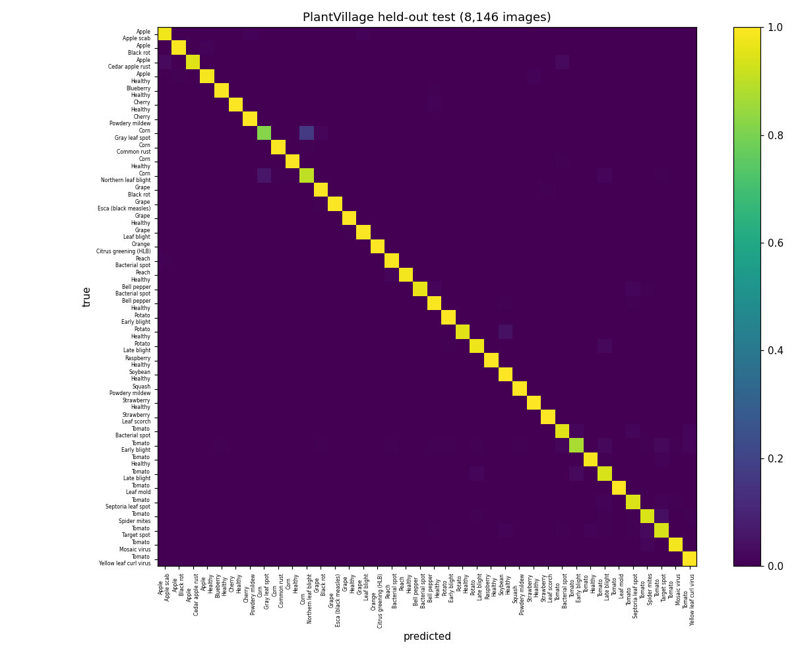
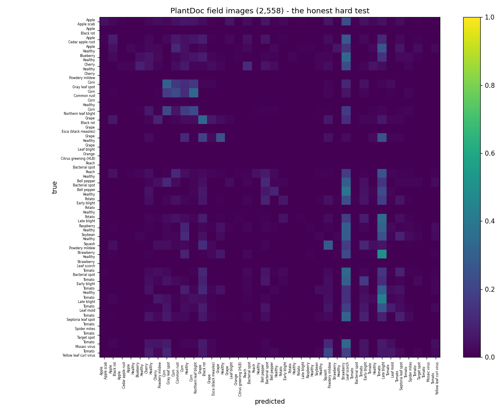

# 🌿 دكتور النبات | Plant Doctor

**Photograph a plant leaf, get the disease and the treatment — in Arabic, in your browser, on real data.**

**صوّر ورقة نبات بالموبايل، واعرف المرض والعلاج بالعربي. النموذج يعمل بالكامل داخل المتصفح (الصورة لا تغادر جهازك).**

Built for Egyptian farmers, gardeners and plant owners. 38 classes across 14 plant species (tomato, potato, corn, grapes, pepper, apple, peach, strawberry...), each with agronomic advice in Arabic.

## Live demo

**https://mahmoudabdalhamid10-alt.github.io/plant-doctor/** — runs 100% client-side (ONNX Runtime Web). No server, no upload.

## The data (100% real photos, nothing synthetic)

| Dataset | What it is | Size | Used for |
|---|---|---|---|
| [PlantVillage](https://github.com/spMohanty/PlantVillage-Dataset) (via [HF mirror](https://huggingface.co/datasets/dpdl-benchmark/plant_village)) | Real leaf photos, single leaf on uniform background (Hughes & Salathé, 2015) | 54,303 images / 38 classes | Training + in-domain test |
| [PlantDoc](https://github.com/pratikkayal/PlantDoc-Dataset) (via [HF mirror](https://huggingface.co/datasets/agyaatcoder/PlantDoc)) | Real **field** photos taken in natural conditions (Singh et al., 2019) | 2,558 images + 8,139 leaf crops / 28 mappable classes | **Out-of-domain "field test"** |

Class-index mapping for the mirror was verified empirically against the official per-class counts from the PlantVillage paper.

## Results (measured, not claimed)

Model: frozen **MobileNetV3-Small** (ImageNet features) → 576-d embeddings → linear classifier trained here (LogReg / LinearSVC / kNN compared; see below). CPU-only training, fully reproducible.

| Evaluation | Accuracy | Macro-F1 | Notes |
|---|---|---|---|
| PlantVillage held-out test (8,146 img) | **97.9%** | 0.972 | the easy, in-domain setting everyone reports |
| PlantVillage test, top-5 | 99.95% | — | |
| PlantVillage test, healthy-vs-diseased | 99.6% | — | |
| **PlantDoc field test (8,139 leaf crops)** | **15.7%** | — | the honest number |
| PlantDoc field, top-5 | 45.0% | — | |
| PlantDoc field, healthy-vs-diseased | 66.6% | — | |

Head comparison on validation macro-F1: LinearSVC 0.972 > LogReg 0.967 > kNN-5 0.937 > majority 0.005. The deployed demo uses the LogReg head (probabilities for user-facing confidence); the LinearSVC head is in `models/head.joblib`.

### The honest part — صور الحقول أصعب بكتير

The model is near-perfect on photos that look like its training data (single leaf, plain background), but accuracy collapses on natural field photos. This is a **known, documented weakness of PlantVillage-trained models**, and this repo measures it instead of hiding it: healthy field leaves get confused across species (the model leans on background/pose cues), while strong-lesion diseases transfer better (tomato late blight 52%, squash powdery mildew 44%).

**What this means in practice:** for best results photograph one leaf up close against a simple background. The demo says this to the user when confidence is low.

**Roadmap to close the gap:** fine-tune (not just the head) with field-style augmentation (backgrounds, lighting, blur) and add PlantDoc-style field images to training.




## Reproduce

```bash
pip install -r requirements.txt
python scripts/download_data.py        # pulls the two datasets (public mirrors)
python scripts/extract_features.py 0 13   # PlantVillage features (CPU, ~6 min)
python scripts/extract_features.py plantdoc
python scripts/extract_features.py plantdoc_crops
python scripts/train_evaluate.py          # trains heads, writes reports/metrics_summary.json
```

## Use as a package

```bash
pip install -e .
python -m plant_doctor.predict path/to/leaf.jpg   # top-3 diagnosis + Arabic advice
```

## Repo layout

- `src/plant_doctor/classes.py` — the 38 classes, Arabic names, per-disease treatment advice
- `src/plant_doctor/features.py` — MobileNetV3 feature extractor
- `scripts/` — download → features → train → evaluate pipeline
- `docs/` — the in-browser demo (GitHub Pages): ONNX backbone + JSON head
- `reports/` — metrics JSON + confusion-matrix figures
- `tests/` — unit tests (CI on every push)

## Limits

- Diagnosis from a leaf photo is indicative, not a lab confirmation (HLB especially must be lab-confirmed).
- Field-photo accuracy is low today (see above); treat low-confidence answers as hints.
- Coverage: 14 species only. A crop outside the list will get a wrong, confident-sounding answer.

## AI-assistance disclosure

This project (code, pipeline, demo, README) was built by an AI assistant (Instinct) on behalf of Mahmoud Abdel Hamid, who owns the repository and reviewed the goal and the results. No results are synthetic or cherry-picked; the bad numbers are printed next to the good ones on purpose.

## License & data credits

Code: MIT (see LICENSE). PlantVillage data © its authors (Hughes & Salathé, 2015 — arXiv:1511.08060). PlantDoc data © its authors (Singh et al., 2019 — arXiv:1911.10317), CC BY 4.0. Treatment advice is general agronomic guidance, not professional consultation.
